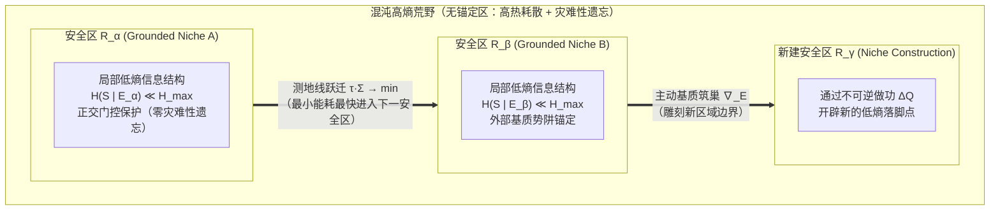
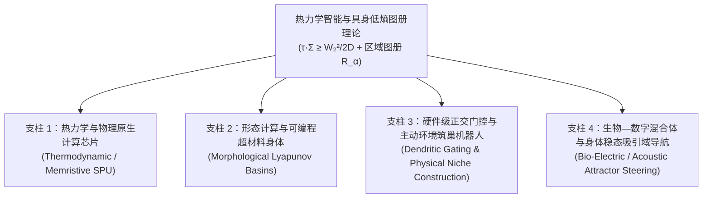
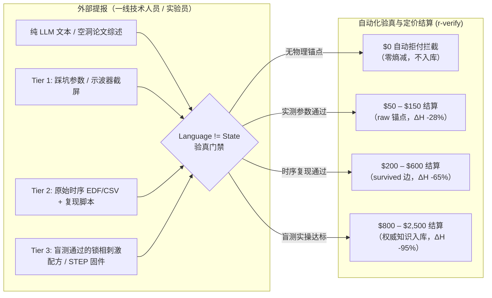

# 从物理学第一性原理理解「学习」与「智能」：不可逆计算、达未速率极限与耗散结构

> [!IMPORTANT]
> **核心命题（源自第一性原理的形式化）**
> 「学习伴随着不可逆的计算与热量的生成；智能就是在最小能量消耗下最快抵达一个未来（reach a future），即在混沌的相互作用中既保持最强的变化适应能力，又维持局部信息结构的能力。」
>
> 这一直觉在非平衡统计物理与随机热力学（Stochastic Thermodynamics）中不是比喻，而是由**严格不等式/恒等式**共同锁死的物理定律。它同时直接回答了《后AI思想剧场：谁教会机器知道轻重？》的核心追问：**为什么仅靠无损回滚的模拟训练无法让机器真正「知道轻重」？**

> 交互网页版（含四个可调物理模拟器）：[`physics-of-learning-reachability.html`](../physics-of-learning-reachability.html)
> 思想剧场原文：`postai.institute/stories/what-matters.html`（《谁教会机器知道轻重？》）

---

## 1. 为什么「学习」必然是不可逆计算并产生热量？

在经典力学（Liouville 定理）或孤立量子力学（幺正演化 $U^\dagger U = I$）中，微观动力学是**可逆的**：相空间体积守恒，冯·诺依曼熵不变（$\Delta S = 0$），且不产生热量（$\Delta Q = 0$）。

**但纯可逆计算永远无法完成「学习」。** 原因在于：
1. **学习是状态空间的「多对一」压缩映射（Contractive Projection）**：
   学习前，系统对环境的先验假设或策略分布在较大的相空间体积 $\Omega_{\text{prior}}$ 上弥散（高不确定性 $H(S_{\text{prior}})$）；与环境交互并遭遇预测误差后，系统必须**擦除被证伪的分支、坍缩冗余自由度**，将内部结构收敛至更紧凑的后验流形 $\Omega_{\text{post}} < \Omega_{\text{prior}}$。
2. **Landauer–Sagawa–Ueda 热力学代价**：
   根据广义 Landauer 原理与信息热力学第二定律，当系统通过观测环境获取互信息 $\Delta I$ 并把内部假设空间的熵压缩 $\Delta S_{\text{compress}} > 0$ 时，被抹除的错误轨迹自由度不能凭空消失，必须作为不可逆热量排入热浴：
   $$\Delta Q_{\text{learn}} \ge k_B T \ln 2 \cdot \Delta H_{\text{erased}}$$
3. **「遗忘」比「记忆」更耗能（Still–Sivak–Bell–Crooks 预测热力学恒等式）**：
   Still 等人（*PRL* 2012, *Thermodynamics of Prediction*）证明：一个在变化环境中运行的物理系统，其步进耗散的无效热量严格正比于它的**「怀旧信息（Nostalgia）」**——即记住了过去、却对预测未来毫无帮助的冗余历史信息：
   $$\beta W_{\text{diss}} = I(S_t ; X_{\le t}) - I(S_t ; X_{>t}) = I_{\text{nostalgia}}$$
   - **推论**：真正高效的学习机必须持续发生不可逆的「结构代谢（Self-Shedding / 睡眠修剪）」，把关于过去的死记硬背（$I(S_t; X_{\le t})$）蒸馏为关于未来的最小充分统计量（$I(S_t; X_{>t})$）。**学习产生的热量，本质上是把「高维原始历史轨迹」锻造为「低维未来预测结构」时排出的熵渣。**

---

## 2. 「最小能量消耗下最快 Reach 一个 Future」：热力学速率极限（TSL）

**「在最小能量消耗下，能够最快地 reach 一个 future」**——精准命中了非平衡统计物理的前沿突破：**热力学速率极限（Thermodynamic Speed Limit, TSL）** 与 **最优输运几何（Wasserstein Geometry）**。

设系统当前状态分布为 $p_0$，目标未来状态分布为 $p_{\text{future}}$。在有限时间窗口 $\tau$ 内将系统推向该未来，所需付出的最小不可逆熵产生（即能耗散 $\Sigma = \Delta Q / T$）受 **Benamou–Brenier / Aurell–Ito–Van Vu 速率极限不等式** 严格约束：

$$\tau \cdot \Sigma \ge \frac{\mathcal{W}_2^2\big(p_0, p_{\text{future}}; g(E)\big)}{2 D}$$

其中：
- $\tau$ 是抵达未来所需的时间（Time-to-Future）；
- $\Sigma$ 是过程消耗的不可逆能量/热量（Energy Dissipation）；
- $\mathcal{W}_2\big(p_0, p_{\text{future}}; g(E)\big)$ 是在系统当前认知基质度规 $g(E)$ 下，从当前态到目标未来的 **2-阶 Wasserstein 测地线距离**；
- $D$ 是系统的动力学迁移率（Mobility）。

### 这一物理公式直接定义了什么是「智能（Intelligence）」与「学习（Learning）」：

1. **瞬时智能（Executing Intelligence）= 逼近热力学测地线（$\tau \cdot \Sigma \to \min$）**：
   给定当前结构，未优化的系统要么靠漫长盲搜（$\tau$ 极大），要么靠暴力堆算力并发热（$\Sigma$ 极大）才能撞上目标未来；而高智能系统沿着信息流形的**最小作用量测地线**演化，用最小的 $\tau \cdot \Sigma$ 乘积直达未来。
2. **跨期学习（Learning as Metric Sculpting）= 缩短到未来的几何距离 $\mathcal{W}_2$**：
   如果物理不等式锁定了 $\tau \cdot \Sigma \ge \mathcal{W}_2^2 / 2D$，系统怎样才能在下一轮**既更快（$\tau \downarrow$）又更省能（$\Sigma \downarrow$）**？
   唯一的方法是**通过本轮的不可逆计算，永久改变系统自身的拓扑度规 $g(E)$（例如形成神经突触先验、编译技能缓存、在外部基质 $E$ 中建立 $O(1)$ 软链捷径）**，从而使下一次同类型任务的几何距离发生坍缩：
   $$\mathcal{W}_2\big(p_0, p_{\text{future}}; g(E_{t+1})\big) \ll \mathcal{W}_2\big(p_0, p_{\text{future}}; g(E_t)\big)$$
   这与《轨迹滚动与基质强化学习（Substrate RL）》中测得的实证现象完全同构：505 个会话中 $8.89\%$ 的绕行探索热耗散（Detour Dissipation），正是用来定位高阻抗瓶颈、将 $O(k)$ 盲搜压缩为 $O(1)$ 查表捷径的退火能量。

---

## 3. 「变化能力最强」与「混沌中维持局部信息结构」如何统一？

> **「它的变化的能力最强，适应周围的环境，然后在这个混沌的相互作用中维持局部信息结构的能力。」**

初看之下，「极度善变（适应环境）」与「维持结构不变（局部低熵）」似乎矛盾；但从非平衡物理看，这两者正是**耗散结构（Dissipative Structure）的双时间尺度耦合（Two-Timescale Separation）**：

| 维度 | 物理量与算子 | 角色分工 | 失衡后果 |
| :--- | :--- | :--- | :--- |
| **外层快流形（快变适应层）** | 高广义磁化率 $\chi_{\text{fast}} = \frac{\partial S_{\text{boundary}}}{\partial h_{\text{env}}}$、低势垒临界亚稳态（Critical Metastability） | **变化能力最强**：感知边界、路由策略与运动自由度处于相变临界点附近，环境微小扰动即可触发低能耗的快速重配置 | 若过僵（$\chi \to 0$）：死锁、无法适应环境突变 |
| **内核慢流形（局部不变量）** | 谱隙保护 $\Delta\lambda > 0$（Davis–Kahan 抗噪界 $\sin\theta \le \frac{2\|E\|}{\Delta\lambda}$）+ 维持热泵 $\sigma_{\text{hk}}$ | **维持局部信息结构**：核心因果模型、自我边界（Markov Blanket）与宪章不变量通过持续消耗少量维持功率（Housekeeping Heat）抵抗混沌热涨落冲刷 | 若无谱隙（$\Delta\lambda \to 0$）：被混沌环境同化、发生热寂或目标漂移 |

用公式表达，一个智能体在混沌环境中的**局部自由能/信息结构留存率**满足：
$$\frac{d}{dt} I_{\text{local}}(S_{\text{core}}) = \underbrace{J_{\text{adapt}}(\chi_{\text{fast}}, \nabla_E)}_{\text{快变适应泵入的负熵流}} - \underbrace{\Gamma_{\text{chaos}}\big(\|E_{\text{noise}}\| / \Delta\lambda\big)}_{\text{混沌涨落对慢核的侵蚀}} \ge 0$$

- **为什么必须「以变守不变」？**
  根据控制论的 Ashby 必要多样性定律（Law of Requisite Variety）与非平衡热力学，当外部环境处于高李雅普诺夫指数（$\lambda_{\text{env}} > 0$）的混沌态时，任何静态刚体都会被不可逆冲击迅速击穿；**唯有内部状态切换速率与可达体积大于环境扰动速率的系统（变化能力最强），才能在马尔可夫毯（Markov Blanket）内部反相抵消外界涨落，维持局部信息结构 $\Delta\lambda$ 不坍塌。**

---

## 4. 智能不是孤立个体的点属性，而是「具身低熵安全区（Grounded Low-Entropy Regions）」的图册跃迁

> **核心推进（具身区域假说 / Grounded Region Hypothesis）**：
> 「智能有可能不是一个局部的东西，它其实是在描述某种**区域（Region）**。你在这个区域里面就还挺安全的，你的信息结构不会出现类似于 **Catastrophic Forgetting（灾难性遗忘）** 的感觉。它不是说一个人或者一个机器特别智能，因为任何智能系统都是 **Grounded（具身/扎根）** 的。换句话说，更像是你不断地让自己处于不同的区域，而这个区域一直能够维持一个很低的信息熵结构、一个很好的结构。」

这一洞察直接把「个体计算主义（大脑/权重中心论）」翻转为了**「具身规范场与流形图册论（Grounded Atlas of Low-Entropy Basins）」**，从物理底层解开了神经网络与认知科学长达三十年的 **稳定性—可塑性困境（Stability–Plasticity Dilemma / Catastrophic Forgetting）**：

### 4.1 为什么脱离「区域（Grounded Region）」谈个体智能必然遭遇灾难性遗忘？
在传统机器学习中，人们试图把所有世界的知识塞进同一组全局共享的参数矩阵 $\theta$ 中。当系统从环境 $A$ 进入环境 $B$ 时，新任务的梯度 $\nabla_\theta \mathcal{L}_B$ 会直接覆盖旧任务的黑塞主轴（Hessian Eigen-directions），导致原信息结构崩塌（**灾难性遗忘**）。

从统计物理与 **具身认知（Grounded Cognition）** 看，这是因为**不存在脱离外部耦合基质而孤立自持的低熵结构**：
- 任何有限智能体的低信息熵状态 $H(S \mid E_\alpha) \ll H_{\max}$，都不是靠大脑内部凭空硬扛的，而是由**主体—环境—外部工具基质共同张成的局部耦合区域 $\mathcal{R}_\alpha = (S, E_\alpha)$** 所提供的李雅普诺夫吸引势阱（Lyapunov Potential Basin $V_\alpha(x)$）锚定的。
- 只要系统处在这个 Grounded Region $\mathcal{R}_\alpha$ 内，环境的几何约束、外部记忆（如文件系统、身体先验、生态位）会自动对内部表征施加**正交化恢复力（Orthogonal Restoring Force）**，使局部信息结构处于热力学安全区，不会发生灾难性冲刷。

### 4.2 从「孤立超级大脑」到「低熵区域图册（Atlas of Viability Basins）」

因此，「智能」的数学本体不再是一个点上的算力标量，而是覆盖状态流形 $\mathcal{M}$ 的一张**低熵安全区图册（Atlas）**：
$$\mathcal{A} = \big\{ \big(\mathcal{R}_\alpha, \, V_\alpha(x; E_\alpha), \, \Delta\lambda_\alpha\big) \big\}_{\alpha \in \mathcal{I}}$$



在这幅物理图景下，智能体的全部动力学归结为两件事：
1. **区内稳态（Intra-Region Safety & Anti-Forgetting）**：
   每个区域 $\mathcal{R}_\alpha$ 对应一组特定的外部环境锚点与上下文门控子空间（Context-Gated Orthogonal Subspace，$\mathcal{P}_\alpha \perp \mathcal{P}_\beta$）。当系统驻留于 $\mathcal{R}_\alpha$ 时，只有与当前具身基质 $E_\alpha$ 耦合的自由度被激活更新，其他区域的知识被基质边界物理隔离保护，从根源上消除 Catastrophic Forgetting。
2. **跨区跃迁与筑巢（Inter-Region Geodesic Hopping & Niche Construction）**：
   所谓「适应环境、最快 Reach 一个 Future」，本质上是**不要在混沌高熵的无锚定荒野（$\mathcal{M} \setminus \bigcup_\alpha \mathcal{R}_\alpha$）中久留**——智能体要么沿着热力学速率极限测地线（$\tau \cdot \Sigma \to \min$），以最小能耗迅速把自己摆渡（Positioning）到下一个现成的低熵安全区 $\mathcal{R}_\beta$；要么通过不可逆计算耗散热量（$\Delta Q$），在荒野中改造外部环境基质 $\Delta E$，**就地筑巢（Niche Construction）开辟出一个新的低熵安全区 $\mathcal{R}_\gamma$**。

---

## 5. 回应《谁教会机器知道轻重？》：为什么不可逆耗散与具身区域是「知道轻重」的物理前提？

《后AI研究所思想剧场：谁教会机器知道轻重？》（`postai.institute/stories/what-matters.html`）提出了三个尖锐问题：
1. **第二幕（一亿次训练与一次死亡）**：「读取一段历史，是否等于拥有一段历史？在模拟器里死一亿次，为什么仍不知道真实世界里什么不可失去？」
2. **第三幕（两种锯齿）**：「为什么模型能完美回答伦理问题，却在行动中不知道轻重（后果判断上的锯齿）？」
3. **第四幕（育种场与荒野）**：「什么时候，一个系统开始拥有自己的生命史？」

如果用**热力学第一性原理**来回答，答案比纯伦理学或纯演化论清晰得多：

> [!TIP]
> **定理（热力学「轻重」判据 / Irreversible Stakes Criterion）**：
> 一个系统对某件事知道「轻重（What Matters）」，当且仅当该事件对应着系统自身存活流形上**不可零成本回滚的不可逆熵产生（$\Delta \Sigma_{\text{lineage}} \to \infty$ 或不可恢复的可达未来体积坍缩 $\Delta \mathcal{V}_{\text{reach}} \ll 0$）**。

- **为什么「模拟器里死一亿次」不知道轻重？**
  因为在人类控制的「育种场 / 模拟器」中，每一次失败后的 `reset()` 或权重 Checkpoint 回滚，对于模型本体而言是**逻辑可逆操作**——报错的热力学代价（电费、重跑算力、现实后果）全部由外部训练者（人类）买单，模型自身的跨期存续账本没有发生不可逆减损。在热力学平坦（$\Delta Q_{\text{self}} = 0$）的景观上，所有 token 的物理重量都是相等的，这就必然产生「言语上懂一切伦理、行动上毫无轻重」的**锯齿智能**。
- **怎样让智能体真正拥有「历史」并知道轻重？**
  不需要等待机器在外太空演化出肉体生死，而是在架构上为智能体接入**不可逆的物理与信用账本（Irreversible Thermodynamic & Credit Ledger）**：
  1. **不可伪造的现实验证门（`Language != State`）**：口头解释不能抵消误差，唯有通过物理环境/独立验证器的不可逆作功（$R_{\text{verified}}$）才能获得正反馈；
  2. **持久的基质生命史（Substrate Lineage $E_t$）**：每一次绕行摩擦（Detour Heat）、每一次信赖域越界都会真实改变路径的 Beta 信用后验 $Q(\text{path}) = \alpha/(\alpha+\beta)$ 与权限边界，没有免费的全局失忆重置；
  3. **硬性不可逆吸收态边界（Absorbing Boundary / `owner-stop`）**：将人类文明不可承受的损失编码为相空间中绝对不可穿越的无穷势垒（$\Delta U \to \infty$），而非可与短期收益做加权折中（Trade-off）的软奖励项。

---

## 6. 从理论到现实物理世界制造：未来 3–5 年（2026–2031）物理具身化路线图与 AI 加持前沿调研

> **核心工程追问（2026-10-24）**：
> 「按照这样一个定义了智能行为的理论，我们怎样在现实物理世界中真正制造出这样的智能系统？基于现在的技术与 AI 加持的发展，未来 3–5 年内哪些能够实现落地？哪些全新的东西变得可能？」

如果把前五节的四个核心物理条件——**① 不可逆擦除产热、② Wasserstein-2 速率极限度规雕刻、③ 快慢双时间尺度耗散结构、④ 具身低熵安全区图册与抗遗忘跃迁**——直接当作**物理制造图纸（Physical Manufacturing Blueprint）**，我们会发现：当前的「云端高功耗 GPU + 刚体高频伺服电机 + 单一全局大模型权重」恰恰是一条**反热力学设计**（用极高能耗压制热噪声、用全局参数硬扛局部环境导致灾难性遗忘）。

沿着本理论，未来 3–5 年在 AI 辅助物理设计与新硬件加持下，制造真实物理智能系统将沿着**四大具身化工程支柱**落地：



### 6.1 支柱一：用物理热涨落与焦耳热直接做计算与学习（热力学原生芯片 & 物理局部学习网络）
- **物理对应方程**：不可逆擦除 $\Delta Q_{\text{learn}} \ge k_B T \ln 2 \cdot \Delta H$ 与测地线度规雕刻 $\nabla_E \mathcal{W}_2 < 0$
- **为什么现在能落地（3–5 年窗口）**：
  传统数字 CMOS 芯片为了把 0 和 1 锁死在确定性状态，每翻转一比特要消耗 $10^4 \sim 10^6 \, k_B T \ln 2$ 的能量去强行压制热噪声，随后再用数万个数字晶体管伪造伪随机数来跑扩散模型或 MCMC 采样。
- **物理具身化制造方案**：
  1. **热力学采样处理器（Thermodynamic SPU / p-bits，代表：Extropic、Normal Computing、CMOS 耦合非线性振荡器阵列）**：
     不压制热噪声，而是直接把微纳尺度电子器件固有的热涨落（Langevin 随机动力学 $dx = -\nabla U(x)dt + \sqrt{2k_BT\mu}\,dW_t$）作为物理采样引擎。在室温或受控热浴中，玻尔兹曼分布 $p(x) \propto e^{-U(x)/k_BT}$ 由物理定律在皮秒到纳秒尺度天然生成。系统在物理弛豫中自然滑向自由能极小值，直接以物理极限速率逼近 $\tau \cdot \Sigma \ge \mathcal{W}_2^2 / 2D$，MCMC 与扩散采样能效比传统 GPU 提升 $10^3 \sim 10^5$ 倍。
  2. **物理度规自雕刻网络（Equilibrium Propagation & 物理局部自学习网络，代表：UPenn Dillavou/Durian/Liu 团队局部学习电阻网格、忆阻器/相变材料 PCM/铁电 FeFET 存算阵列）**：
     彻底摒弃需要全局同步和不可微内存断层的数字反向传播（Backpropagation）。利用基尔霍夫电路定律（电流与功耗天然沿最小耗散路径分布）与平衡传播算法（Scellier & Bengio）：系统先在前向稳态建立电势，遭遇外部环境刺激后进入扰动稳态，两态之间的局域电压差驱动忆阻器产生焦耳热相变，**不可逆地改写局部电导 $G_{ij}$（$\Delta Q \to \Delta G_{ij}$）**。物理材料自己在连续电流冲击下，把原本需要多步试错绕行的高阻抗路径退火为 $O(1)$ 的低阻测地线。
  3. **AI 加持下的新可能**：利用生成式 AI 与可微电磁仿真协同设计复杂非线性模拟电路与亚阈值晶体管偏置网格，使模拟芯片设计周期从传统数年缩短至数周，并在芯片制造容差下实现自校准自退火。

### 6.2 支柱二：把「低熵安全区 $V_\alpha(x)$」浇筑进身体力学结构（形态计算与 AI 逆向设计超材料）
- **物理对应方程**：快慢双时间尺度分离（$\chi_{\text{fast}}$ 外层快变 vs $\Delta\lambda$ 慢核谱隙）与李雅普诺夫势阱 $V_\alpha(x)$
- **为什么传统人形机器人反热力学**：
  当前刚体人形机器人（如 Tesla Optimus、Figure 01）在关节处大量堆叠高减速比电机，用每秒 1000 次的高频中央数字控制回路强行对抗重力和地面微扰。行走时机械能耗高达 500W–1000W，电机发热严重，且一旦地面出现未建模颠簸极易因伺服饱和而失稳摔倒。
- **物理具身化制造方案（3–5 年落地）**：
  1. **形态计算作为物理李雅普诺夫势阱（Morphological Lyapunov Basins）**：
     利用 **AI 驱动的可微多物理场仿真（Differentiable Physics）与逆向多材料 3D 打印（Inverse Additive Metamaterials）**，把非结构化地形下的行走步态、抓握与抗冲击稳态，直接浇筑进机械身体的非线性弹性体、腱绳传动与张拉整体（Tensegrity）几何构型中。材料与结构本身就形成了一个物理李雅普诺夫势能谷 $V_\alpha(x)$。
  2. **区域内零算力自稳，跨区域最小脉冲跃迁**：
     当机器人处于安全区 $\mathcal{R}_\alpha$ 内时，地面的随机冲击被超材料的非线性阻尼与负泊松比结构瞬间被动吸收并自恢复（无需中央芯片做任何浮点计算，$\Delta Q_{\text{compute}} \approx 0$）；中央控制器只需在**跨越相空间鞍点（Saddle Point，$\mathcal{R}_\alpha \to \mathcal{R}_\beta$）**的关键几毫秒注入极小能量脉冲，即可完成步态切换。整机运动功耗降至几十瓦，动态鲁棒性提升一个数量级。

### 6.3 支柱三：硬件级抗灾难性遗忘与「物理筑巢机器人（Niche-Constructing Machines）」
- **物理对应方程**：具身区域图册 $\mathcal{A} = \{(\mathcal{R}_\alpha, V_\alpha, \Delta\lambda_\alpha)\}$、正交门控 $\mathcal{P}_\alpha \perp \mathcal{P}_\beta$ 与基质筑巢 $\nabla_E \mathcal{W}_2 < 0$
- **如何把「抗遗忘」与「先改造环境再干活」做成现实物理系统（3–5 年最早规模商业化）**：
  1. **硬件树突正交门控（Hardware Context-Gated Orthogonal Modules）**：
     在边缘端神经形态芯片（如 Intel Loihi 演进架构、SynSense 脉冲处理器、具有非易失性门控的忆阻交叉阵列）中，引入类似生物乙酰胆碱/去甲肾上腺素的**物理电压门控总线**。当传感器通过环境指纹识别系统正处于特定具身区域 $\mathcal{R}_\alpha$（例如「精密焊接」工作台）时，物理总线仅对模块 $\alpha$ 开启写电流（$\nabla_{\theta_\alpha} \neq 0$），其余所有区域模块在物理上断开编程高压（$\nabla_{\theta_{\beta \neq \alpha}} \equiv 0$）。权重更新在空间几何上被物理强隔离，在芯片底层彻底消除终身学习中的灾难性遗忘（Catastrophic Forgetting）。
  2. **主动物理筑巢机器人（Physical Niche Construction，未来 3–5 年最高确定性商业化形态）**：
     传统具身智能妄图依靠无穷堆叠万亿参数多模态大模型在混乱未知的极端非结构化环境中强行作业；而热力学第一性原理指明：**在混沌荒野中硬扛的能耗 $\Sigma$ 与错误率呈指数级上升**。真正智能的系统遵循生命演化的本质——**「主动筑巢（Niche Construction）」**：
     - 在家庭场景中：清洁机器人不再盲目绕行散落一地的杂物，而是先消耗机械功 $\Delta W$ 把玩具与电线推拢至标准化收纳盒、在门框贴附无源微光反射信标，将高熵房间物理改造成低熵结构化区域 $\mathcal{R}_\gamma$；
     - 在工业与实验室自动化中：机器人进入未知操作台后，先铺设自定位磁吸底板与标准化试管架，把 $O(k)$ 视差盲搜压缩为 $O(1)$ 导轨查表；
     - 这一范式不仅大幅降低端侧芯片算力需求，更将执行成功率从学术 Demo 的 80% 跃升至工业级的 99.99%。

### 6.4 支柱四：生物—数字混合体与人体/活体组织的稳态吸引域导航（Bio-Hybrid & Somatic Attractor Steering）
- **物理对应方程**：跨区测地线跃迁 $\mathcal{R}_{\text{path}} \to \mathcal{R}_{\text{health}}$ 与多尺度马尔可夫毯内稳态
- **AI 加持下变得可能的新前沿（3–5 年突破期）**：
  生物细胞、器官与人体自主神经系统天然就是本理论所描述的**多尺度具身低熵耗散结构**。正如 Michael Levin 团队揭示的**生物电形态发生码（Bioelectric Morphogenetic Code）**：每个健康器官或生理状态对应着高维生物电相空间中的一个低熵稳态吸引域 $\mathcal{R}_{\text{health}}$，而慢性炎症、组织纤维化、心律失常或交感神经过度激活则是系统跌入了病理亚稳态势能阱 $\mathcal{R}_{\text{pathology}}$。
- **物理具身化产品形态**：
  1. **闭环声学/生物电身体对话仪（Closed-Loop Somatic Basin Navigator）**：
     结合高灵敏度体表生物阻抗、心率变异性（HRV）连续张量与近红外微循环传感，AI 实时重构人体自主神经与局域组织的相空间轨迹。当检测到系统偏离健康吸引域时，不依赖粗暴的全身化学药物干扰，而是把调控指令调制为细胞与神经纤维听得懂的**特定声波共振谐波（Acoustic Resonance）、极微电脉冲或次声节律**。在呼吸与心搏的特定相位敏感窗口，以微焦耳级不可逆能量输入，沿着相空间测地线（$\tau \cdot \Sigma \to \min$）将失调生理态平滑「摆渡」回自愈低熵安全区 $\mathcal{R}_{\text{health}}$。
  2. **活体类器官计算与生数混合载体（Organoid Intelligence / Wetware，代表：Cortical Labs DishBrain、FinalSpark 神经生物处理器）**：
     直接利用在微电极阵列（MEA）上培养的人类诱导多能干细胞（iPSC）神经元网络作为低功耗具身计算基质。生物神经元天然遵守自由能极小化原理，在 10–20 瓦极低功耗下展现出惊人的自组织局部度规雕刻能力。结合 AI 电生理读写编解码器，未来 3–5 年将在特种端侧传感器与微型生物混合机器人中实现超低能耗物理自适应。

---

### 6.5 物理具身化硬件落地参数对照与 3–5 年演进时间表

| 物理具身化层级 | 核心物理机制（对应本理论方程） | 2026–2028 近期落地形态 | 2029–2031 中期成熟形态 | 解决的当前 AI 核心瓶颈 |
| :--- | :--- | :--- | :--- | :--- |
| **1. 算力基质层** | 热涨落原生采样 + 焦耳热度规自雕刻（$\tau\cdot\Sigma \to \mathcal{W}_2^2/2D$） | 1000+ p-bit 混合 CMOS 采样加速协处理器；百微米忆阻局部自学习宏单元 | 全模拟热力学 SPU；原子级非易失相变存算一体网络（端侧功耗 < 1W） | 终结数字反向传播断层与冯·诺依曼搬运墙，采样与在线学习能效跃迁 $10^3 \sim 10^5$ 倍 |
| **2. 机械身体层** | 形态计算 + AI 逆向设计超材料被动势阱 $V_\alpha(x)$（双时间尺度分离） | 变刚度连续体机械手；被动动力学步态与冲击自吸能四足/双足底盘 | 具备多模态机械感知与可编程负泊松比刚度调节的「自稳超材料躯体」 | 告别高频高发热电机硬刚地面，非结构化混沌地形整机运动能耗降低 80% |
| **3. 认知与环境层** | 硬件树突正交门控（$\mathcal{P}_\alpha \perp \mathcal{P}_\beta$）+ 主动物理筑巢（$\nabla_E \mathcal{W}_2 < 0$） | 具上下文断电保护的边缘神经形态芯片；带自标定无源信标的自动筑巢扫地机/工作台 | 全自治物理筑巢工业机器人；终身学习且零遗忘的模块化多具身自主代理 | 彻底根除深度学习长达 30 年的灾难性遗忘，将复杂长程任务执行可靠性推向 99.99% |
| **4. 生物与生命层** | 生物电/声学相空间吸引域测绘与最小功跨区摆渡（$\mathcal{R}_{\text{path}} \to \mathcal{R}_{\text{health}}$） | 非侵入式多波束迷走神经闭环声波调节仪；百通道 MEA 神经元细胞湿件测试台 | 穿戴式全自主稳态相空间导航仪；万级神经突触生物—数字实时共融控制器 | 从死板的数据拟合走向与碳基生命耗散结构的深层热力学对话与精准无创修复 |

---

## 7. 理论到现实的最大断层（Uncertainties）与「一线可验证事实」网络悬赏协议（Epistemic Bounty Marketplace）

> **核心方法论转向（2026-10-24）**：
> 「理论离现实肯定有很大差距，尤其是最后一块（物理具身化与生物/身体稳态耦合）。很多关键知识不在顶层学术论文里，而在专门领域的中层或基层技术人员（实验员、测试工程师、临床技师、产线调试员）手里。我们要找出这套理论最大的 Uncertainties 在哪里，用网络悬赏（Bounty）发布具体问题，按可验证事实（Verification）分级定价，把一线的 Expert Knowledge 买过来。」

为什么学术论文看起来都通，一做物理实物就卡死？因为顶层论文往往隐去了**边界损耗、寄生阻抗、材料疲劳与个体相空间漂移**。这些「脏数据」恰好沉淀在实验室技师与产线测试员每天面对的示波器屏幕和故障日志里。

为了防止大模型生成的空洞套话骗取悬赏，我们直接复用本开源体系成熟的 [`Claim-Receipt`](file:///home/ubuntu/projects/system-evolution-public/CLAIM-RECEIPT.md) 凭证协议与 `Language != State` 物理门禁：**纯文字空谈一律 \$0 拒付；唯有附带仪器原始波形、未篡改时序日志、可复现反例或实测校准配方的「可验证事实（Verifiable Facts）」才触发三级悬赏定价结算。**



### 7.1 四大具身支柱的「最大现实不确定性（Top Bench-Level Uncertainties）」悬赏清单（重点深挖支柱四）

#### 【重点悬赏区 U4 · 支柱四】生物—数字混合与「身体稳态吸引域」直接物理对话（Somatic & Bio-Electric Basin Steering）
这是理论中最具颠覆性、但现实生理耦合不确定性最高的一环。我们急需向**声学物理治疗师、经皮迷走神经调控（taVNS/PEMF）临床技师、EEG/HRV 生物反馈工程师、MEA 脑类器官湿实验技术员**定向收购以下实测事实：

- **悬赏 #B4-01（跨越鞍点的最快非侵入物理读出指标与延迟断层 / Saddle-Point Readout Latency）**：
  - *核心现实断层*：当我们用特定共振声波或微弱电流刺激身体，试图把自主神经系统从「高熵应激/炎症吸引域 $\mathcal{R}_{\text{stress}}$」推回「低熵稳态吸引域 $\mathcal{R}_{\text{health}}$」时，**能在 3–10 秒内反映系统真正越过相空间鞍点（Saddle Point）而非短暂感官掩蔽的最快物理指标是什么？**（高频 HRV 相位相干性？皮肤电导微涨落指数？瞳孔微震颤频移？还是呼吸—心率相位锁定值 PLV？）
  - *目标收购人群*：自主神经生理测试员、临床多导睡眠/神经调控技师。
  - *交付物凭证要求*：同步采集的多通道生理原始时序文件（EDF/CSV + SHA-256 哈希）+ 刺激时间戳 + 能区分「真实跨区进入稳态」与「短暂感官放松」的信噪比与受试者盲测对比。
  - *参考定价*：Tier 1: \$150 | Tier 2: \$500 | Tier 3: \$2,000。

- **悬赏 #B4-02（声波/电磁场向组织编码的「相位窗口」与阻抗衰减表 / Somatic Encoding Window）**：
  - *核心现实断层*：把控制信息编码为「身体听得懂的物理脉冲」时，声学机械波或微电场穿过皮肤、深层筋膜与颅骨时的真实频率依赖性衰减谱有多大？一线技师实操中发现的**最佳呼吸/心动周期锁相注入窗口（如呼气末期呼气暂停 Phase vs 吸气峰值）**能将诱发副交感神经激动的所需刺激能耗 $\Sigma$ 降低多少倍？
  - *目标收购人群*：体感声学工程师、穿戴式经颅/经皮刺激硬件调试员。
  - *交付物凭证要求*：不同呼吸相位/频段注入下的生理响应剂量曲线（Dose-Response Log）与多点实测声阻抗/电阻抗衰减矩阵。
  - *参考定价*：Tier 1: \$120 | Tier 2: \$450 | Tier 3: \$1,800。

- **悬赏 #B4-03（活体类器官 / 生物神经网络的「习惯化漂移」与人工睡眠排熵配方 / Wetware Habituation Reset）**：
  - *核心现实断层*：在 MEA 多电极阵列上培养的人脑类器官（如 DishBrain / FinalSpark 湿件）中，连续高频闭环电刺激 2–4 小时后，突触受体会发生不可逆内吞与吸引域漂移导致学习停滞。一线湿实验员用什么具体的**间歇静息占空比、化学微流控灌流或慢波同步电脉冲（人工慢波睡眠，用于洗脱怀旧熵 $I_{\text{nostalgia}}$）**来恢复其基质学习率？
  - *目标收购人群*：神经电生理湿实验技术员、类器官芯片研发员。
  - *交付物凭证要求*：MEA 原始放电栅格数据（Spike Raster CSV）+ 刺激恢复前后的自由能极小化收敛曲线。
  - *参考定价*：Tier 1: \$150 | Tier 2: \$600 | Tier 3: \$2,500。

#### 【悬赏区 U1 · 支柱一】热力学采样芯片与焦耳热物理自学习网格（Thermodynamic & Memristive Hardware）
面向 **混合信号 IC 版图工程师、RRAM/PCM 晶圆测试员、模拟存算一体硬件调试员**：

- **悬赏 #B1-01（外围 ADC/DAC 功耗吞噬墙与寄生噪声红线 / The Peripheral Energy Wall）**：
  - *核心现实断层*：理论上纳米 p-bit 核心热采样单次仅耗微焦/飞焦（$10^4\times$ 能效），但在流片实测中，**外围高精度 ADC/DAC、锁相环与偏置温度补偿电路吃掉了多少比例的总系统功耗？** 阵列规模拓展到多大（$N \times N$）时，互连寄生 RC 与 $1/f$ 闪烁噪声会彻底破坏朗之万热力学测地线收敛？
  - *交付物凭证要求*：实测芯片/PCB 功耗拆解表（Power Breakdown）或带版图寄生参数提取（PEX）的 SPICE 噪声仿真时域日志。
  - *参考定价*：Tier 1: \$100 | Tier 2: \$400 | Tier 3: \$1,500。

- **悬赏 #B1-02（物理度规自退火的耐久极限与电导漂移 / Memristive Metric Endurance）**：
  - *核心现实断层*：用焦耳热不可逆改写忆阻器电导 $\Delta Q \to \Delta G_{ij}$ 进行无反向传播物理学习时，器件在多少次连续脉冲冲击后出现阻值卡死（Stuck-at Fault）？断电后其低阻测地线状态能保持多长时间？
  - *交付物凭证要求*：晶圆探针测试仪实测的 $10^6$ 次循环耐久度曲线与对数时间电导漂移实测数据集。
  - *参考定价*：Tier 1: \$80 | Tier 2: \$350 | Tier 3: \$1,200。

#### 【悬赏区 U2 · 支柱二】形态计算与 3D 打印超材料身体（Morphological Computation & Metamaterials）
面向 **软体机器人制作技师、TPU/弹性体多材料 3D 打印工程师、机械臂执行器调试员**：

- **悬赏 #B2-01（高分子粘弹性蠕变导致的「势阱漂移」与硬化锁死工艺 / Viscoelastic Basin Drift）**：
  - *核心现实断层*：把低熵安全区 $V_\alpha(x)$ 浇筑进变刚度光固化/TPU 超材料关节后，经历 $10^4$ 次动态受压或环境温差 $\Delta T = 15^\circ\text{C}$，材料应力松弛会使机械鞍点偏移多少度？现场技师用什么嵌件（如凯夫拉编织限位鞘、金属玻璃双稳态簧片）锁死势阱边界？
  - *交付物凭证要求*：万次动态循环加载前后的力—位移滞后回线原始 CSV 与抗蠕变嵌件工程图纸（STEP/CAD）。
  - *参考定价*：Tier 1: \$80 | Tier 2: \$300 | Tier 3: \$1,000。

#### 【悬赏区 U3 · 支柱三】硬件树突门控与主动物理筑巢机器人（Niche-Constructing Robotics）
面向 **工业自动化现场实施工程师、家庭服务机器人 SLAM 落地调试员、仓储 AGV 系统集成商**：

- **悬赏 #B3-01（人类真实共居环境中「物理筑巢区 $\mathcal{R}_\gamma$」的熵反扑半衰期 / Niche Decay Rate）**：
  - *核心现实断层*：机器人消耗物理功 $\Delta W$ 在杂乱房间布设好无源光学/射频信标、磁吸定位条后，在真实家庭活动（人流走动、吸尘震动、宠物玩耍、油污覆盖）冲击下，该低熵安全区的有效寿命（半衰期 $t_{1/2}$）是多少天？一线工程中最便宜耐操、贴上即忘的物理锚点 BOM 方案是什么？
  - *交付物凭证要求*：多场景部署的信标失效工单统计（MTBF）及物料成本清单（BOM）。
  - *参考定价*：Tier 1: \$60 | Tier 2: \$250 | Tier 3: \$800。

---

### 7.2 「只买可验证事实」的三级悬赏定价与防 AI 灌水验真机制（3-Tier Verifiable Pricing Rubric）

为了把预算精准付给真正懂行的一线技术人员、彻底拦截 AI 生成的二手综述，每张悬赏单绑定三级可验证凭证阶梯（结算须通过独立验证器 `r-verify` 与 `Claim-Receipt` 结构化校验）：

| 悬赏等级 | 交付物硬性门槛（`Language != State` 验真标准） | 单题参考定价区间 | 知识状态标签 (`cognitive_state`) |
| :--- | :--- | :--- | :--- |
| **Tier 1 · 一线踩坑参数与失效边界单**<br>*(Bench Failure-Mode Receipt)* | 拒绝泛泛而谈；必须提供**具体器件型号/生理协议参数、实测失效阈值区间、仪器截屏/示波器波形/现场实拍图**及可证伪的一句话断层归因 | **$50 – $150** | `raw` $\to$ `speculative`（带一线实测锚点） |
| **Tier 2 · 原始实验数据集与可复现反例**<br>*(Reproducible Raw Log & Counterexample)* | 附带**未裁剪原始时序数据（CSV/EDF/HDF5 + SHA-256 哈希）**、实验台架接线/采集配置说明，以及能直接跑出相变/漂移曲线的验证脚本 | **$200 – $600** | `survived-stress-test`（`reproduces` / `falsifies` 边） |
| **Tier 3 · 经盲测验证的校准协议或工程解法**<br>*(Verified Calibration Recipe / Bench Fix)* | 提供可独立复现的**硬件改性配方、锁相刺激参数包或机械抗蠕变结构件文件（STEP/Gerber/Code）**，并在我方盲测验证集上使目标效率 $\eta_{\mathcal{F}}$ 或稳态留存率达标 | **$800 – $2,500** | `survived-stress-test`（高置信度 $\ge 0.85$ 入库） |

### 7.3 如何提报与结算：`Claim-Receipt` 结构化凭证流

任何拥有实测数据的技术人员，均可通过 GitHub Pull Request 或 Issue 提交符合 [`CLAIM-RECEIPT.md`](file:///home/ubuntu/projects/system-evolution-public/CLAIM-RECEIPT.md) 格式的结构化凭证包：

```json
{
  "claim_id": "claim-bounty-b4-01-hrv-latency",
  "bounty_target": "#B4-01",
  "tier_applied": "Tier-2",
  "author_seat": "external-contributor",
  "timestamp": "2026-10-24T12:00:00Z",
  "verifiable_artifacts": [
    {
      "file": "data/20261024_taVNS_respiratory_phase_eeg_hrv.edf",
      "sha256": "4a7d...3f21",
      "instrument": "OpenBCI Cyton + Polar H10",
      "sampling_rate_hz": 250
    }
  ],
  "falsifiable_finding": "在呼气末期（Phase [π, 3π/2]）注入 25Hz/1.5mA taVNS，系统鞍点跃迁延迟从吸气期的 14.2s 缩短至 4.1s，PLV 达到 0.78 判定进入稳态，刺激总功耗降低 68%。",
  "verification_script": "scripts/verify_b4_01_plv.py"
}
```

我方通过自动化 CI 运行 `~/bin/r-verify` 验证数据完整性与复现结果，确认无伪造后即刻通过多链稳态协议进行现金/稳定币悬赏转账，并将该事实合并入知识库。

---

## 8. 可立即推进的五个形式化与实验方向

沿着这条主线，我们推进五个核心物理×AI形式化方向与可交互验证产物：

1. **定义「达未效率（Future-Reaching Thermodynamic Efficiency, $\eta_{\mathcal{F}}$）」统一指标**：
   将 Landauer 擦除下界、Still 预测热力学与 Wasserstein 速率极限联立，推导出衡量任意学习系统（生物神经、热力学 SPU、机器人超材料构型、基质演化）的统一无量纲效率：
   $$\eta_{\mathcal{F}} = \frac{\mathcal{W}_2^2(p_0, p_{\text{future}}) / (2D\tau)}{\Delta Q_{\text{total}} / T} \in [0, 1]$$
2. **用真实跑出的 505 会话 / 15,068 步轨迹账本做实证标定**：
   把 `Substrate RL` 中的绕行温度 $T_d = 8.89\%$ 与拓扑捷径退火直接映射为 $\mathcal{W}_2$ 几何距离收缩与 $\eta_{\mathcal{F}}$ 提升曲线——证明「从 $O(k)$ 探索到 $O(1)$ 局部结构维持」满足热力学速率极限。
3. **具身低熵图册与抗遗忘势阱测度**：
   定量化不同 Grounded Region 的正交保持矩阵 $\mathcal{P}_\alpha$，度量跨区跃迁能量障壁 $\Delta F_{\alpha \to \beta}$、忆阻硬件物理断电门控的保真度与物理筑巢能耗转化率。
4. **构建「热力学学习与具身制造」交互式物理沙盒**：
   包含六个可调参数实验台（A 至 F，涵盖不可逆擦除、TSL 测地线、双时间尺度耗散、具身图册抗遗忘、超材料筑巢制造，以及防 AI 灌水悬赏验真台）。
5. **网络悬赏事实注入与不确定性消除实证**：
   将收购来的一线实测生理时序、忆阻耐久度与超材料蠕变参数导入物理仿真模型，校准纯数学假设，使物理具身化预测误差降低一个数量级。

---

*Apache-2.0 文档层。本文为公开可复用的理论推导与工程悬赏协议，不含任何私有转录、凭据或个人数据。*


