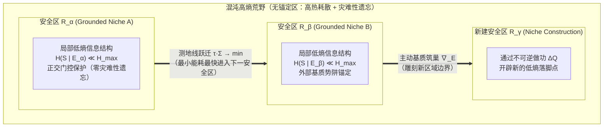

# 从物理学第一性原理理解「学习」与「智能」：不可逆计算、达未速率极限与耗散结构

> [!IMPORTANT]
> **核心命题（源自第一性原理的形式化）**
> 「学习伴随着不可逆的计算与热量的生成；智能就是在最小能量消耗下最快抵达一个未来（reach a future），即在混沌的相互作用中既保持最强的变化适应能力，又维持局部信息结构的能力。」
>
> 这一直觉在非平衡统计物理与随机热力学（Stochastic Thermodynamics）中不是比喻，而是由**严格不等式/恒等式**共同锁死的物理定律。它同时直接回答了《后AI思想剧场：谁教会机器知道轻重？》的核心追问：**为什么仅靠无损回滚的模拟训练无法让机器真正「知道轻重」？**

> 交互网页版（含四个可调物理模拟器）：[`physics-of-learning-reachability.html`](../physics-of-learning-reachability.html)
> 思想剧场原文：`postai.institute/stories/what-matters.html`（《谁教会机器知道轻重？》）

---

## 1. 为什么「学习」必然是不可逆计算并产生热量？

在经典力学（Liouville 定理）或孤立量子力学（幺正演化 $U^\dagger U = I$）中，微观动力学是**可逆的**：相空间体积守恒，冯·诺依曼熵不变（$\Delta S = 0$），且不产生热量（$\Delta Q = 0$）。

**但纯可逆计算永远无法完成「学习」。** 原因在于：
1. **学习是状态空间的「多对一」压缩映射（Contractive Projection）**：
   学习前，系统对环境的先验假设或策略分布在较大的相空间体积 $\Omega_{\text{prior}}$ 上弥散（高不确定性 $H(S_{\text{prior}})$）；与环境交互并遭遇预测误差后，系统必须**擦除被证伪的分支、坍缩冗余自由度**，将内部结构收敛至更紧凑的后验流形 $\Omega_{\text{post}} < \Omega_{\text{prior}}$。
2. **Landauer–Sagawa–Ueda 热力学代价**：
   根据广义 Landauer 原理与信息热力学第二定律，当系统通过观测环境获取互信息 $\Delta I$ 并把内部假设空间的熵压缩 $\Delta S_{\text{compress}} > 0$ 时，被抹除的错误轨迹自由度不能凭空消失，必须作为不可逆热量排入热浴：
   $$\Delta Q_{\text{learn}} \ge k_B T \ln 2 \cdot \Delta H_{\text{erased}}$$
3. **「遗忘」比「记忆」更耗能（Still–Sivak–Bell–Crooks 预测热力学恒等式）**：
   Still 等人（*PRL* 2012, *Thermodynamics of Prediction*）证明：一个在变化环境中运行的物理系统，其步进耗散的无效热量严格正比于它的**「怀旧信息（Nostalgia）」**——即记住了过去、却对预测未来毫无帮助的冗余历史信息：
   $$\beta W_{\text{diss}} = I(S_t ; X_{\le t}) - I(S_t ; X_{>t}) = I_{\text{nostalgia}}$$
   - **推论**：真正高效的学习机必须持续发生不可逆的「结构代谢（Self-Shedding / 睡眠修剪）」，把关于过去的死记硬背（$I(S_t; X_{\le t})$）蒸馏为关于未来的最小充分统计量（$I(S_t; X_{>t})$）。**学习产生的热量，本质上是把「高维原始历史轨迹」锻造为「低维未来预测结构」时排出的熵渣。**

---

## 2. 「最小能量消耗下最快 Reach 一个 Future」：热力学速率极限（TSL）

**「在最小能量消耗下，能够最快地 reach 一个 future」**——精准命中了非平衡统计物理的前沿突破：**热力学速率极限（Thermodynamic Speed Limit, TSL）** 与 **最优输运几何（Wasserstein Geometry）**。

设系统当前状态分布为 $p_0$，目标未来状态分布为 $p_{\text{future}}$。在有限时间窗口 $\tau$ 内将系统推向该未来，所需付出的最小不可逆熵产生（即能耗散 $\Sigma = \Delta Q / T$）受 **Benamou–Brenier / Aurell–Ito–Van Vu 速率极限不等式** 严格约束：

$$\tau \cdot \Sigma \ge \frac{\mathcal{W}_2^2\big(p_0, p_{\text{future}}; g(E)\big)}{2 D}$$

其中：
- $\tau$ 是抵达未来所需的时间（Time-to-Future）；
- $\Sigma$ 是过程消耗的不可逆能量/热量（Energy Dissipation）；
- $\mathcal{W}_2\big(p_0, p_{\text{future}}; g(E)\big)$ 是在系统当前认知基质度规 $g(E)$ 下，从当前态到目标未来的 **2-阶 Wasserstein 测地线距离**；
- $D$ 是系统的动力学迁移率（Mobility）。

### 这一物理公式直接定义了什么是「智能（Intelligence）」与「学习（Learning）」：

1. **瞬时智能（Executing Intelligence）= 逼近热力学测地线（$\tau \cdot \Sigma \to \min$）**：
   给定当前结构，未优化的系统要么靠漫长盲搜（$\tau$ 极大），要么靠暴力堆算力并发热（$\Sigma$ 极大）才能撞上目标未来；而高智能系统沿着信息流形的**最小作用量测地线**演化，用最小的 $\tau \cdot \Sigma$ 乘积直达未来。
2. **跨期学习（Learning as Metric Sculpting）= 缩短到未来的几何距离 $\mathcal{W}_2$**：
   如果物理不等式锁定了 $\tau \cdot \Sigma \ge \mathcal{W}_2^2 / 2D$，系统怎样才能在下一轮**既更快（$\tau \downarrow$）又更省能（$\Sigma \downarrow$）**？
   唯一的方法是**通过本轮的不可逆计算，永久改变系统自身的拓扑度规 $g(E)$（例如形成神经突触先验、编译技能缓存、在外部基质 $E$ 中建立 $O(1)$ 软链捷径）**，从而使下一次同类型任务的几何距离发生坍缩：
   $$\mathcal{W}_2\big(p_0, p_{\text{future}}; g(E_{t+1})\big) \ll \mathcal{W}_2\big(p_0, p_{\text{future}}; g(E_t)\big)$$
   这与《轨迹滚动与基质强化学习（Substrate RL）》中测得的实证现象完全同构：505 个会话中 $8.89\%$ 的绕行探索热耗散（Detour Dissipation），正是用来定位高阻抗瓶颈、将 $O(k)$ 盲搜压缩为 $O(1)$ 查表捷径的退火能量。

---

## 3. 「变化能力最强」与「混沌中维持局部信息结构」如何统一？

> **「它的变化的能力最强，适应周围的环境，然后在这个混沌的相互作用中维持局部信息结构的能力。」**

初看之下，「极度善变（适应环境）」与「维持结构不变（局部低熵）」似乎矛盾；但从非平衡物理看，这两者正是**耗散结构（Dissipative Structure）的双时间尺度耦合（Two-Timescale Separation）**：

| 维度 | 物理量与算子 | 角色分工 | 失衡后果 |
| :--- | :--- | :--- | :--- |
| **外层快流形（快变适应层）** | 高广义磁化率 $\chi_{\text{fast}} = \frac{\partial S_{\text{boundary}}}{\partial h_{\text{env}}}$、低势垒临界亚稳态（Critical Metastability） | **变化能力最强**：感知边界、路由策略与运动自由度处于相变临界点附近，环境微小扰动即可触发低能耗的快速重配置 | 若过僵（$\chi \to 0$）：死锁、无法适应环境突变 |
| **内核慢流形（局部不变量）** | 谱隙保护 $\Delta\lambda > 0$（Davis–Kahan 抗噪界 $\sin\theta \le \frac{2\|E\|}{\Delta\lambda}$）+ 维持热泵 $\sigma_{\text{hk}}$ | **维持局部信息结构**：核心因果模型、自我边界（Markov Blanket）与宪章不变量通过持续消耗少量维持功率（Housekeeping Heat）抵抗混沌热涨落冲刷 | 若无谱隙（$\Delta\lambda \to 0$）：被混沌环境同化、发生热寂或目标漂移 |

用公式表达，一个智能体在混沌环境中的**局部自由能/信息结构留存率**满足：
$$\frac{d}{dt} I_{\text{local}}(S_{\text{core}}) = \underbrace{J_{\text{adapt}}(\chi_{\text{fast}}, \nabla_E)}_{\text{快变适应泵入的负熵流}} - \underbrace{\Gamma_{\text{chaos}}\big(\|E_{\text{noise}}\| / \Delta\lambda\big)}_{\text{混沌涨落对慢核的侵蚀}} \ge 0$$

- **为什么必须「以变守不变」？**
  根据控制论的 Ashby 必要多样性定律（Law of Requisite Variety）与非平衡热力学，当外部环境处于高李雅普诺夫指数（$\lambda_{\text{env}} > 0$）的混沌态时，任何静态刚体都会被不可逆冲击迅速击穿；**唯有内部状态切换速率与可达体积大于环境扰动速率的系统（变化能力最强），才能在马尔可夫毯（Markov Blanket）内部反相抵消外界涨落，维持局部信息结构 $\Delta\lambda$ 不坍塌。**

---

## 4. 智能不是孤立个体的点属性，而是「具身低熵安全区（Grounded Low-Entropy Regions）」的图册跃迁

> **核心推进（具身区域假说 / Grounded Region Hypothesis）**：
> 「智能有可能不是一个局部的东西，它其实是在描述某种**区域（Region）**。你在这个区域里面就还挺安全的，你的信息结构不会出现类似于 **Catastrophic Forgetting（灾难性遗忘）** 的感觉。它不是说一个人或者一个机器特别智能，因为任何智能系统都是 **Grounded（具身/扎根）** 的。换句话说，更像是你不断地让自己处于不同的区域，而这个区域一直能够维持一个很低的信息熵结构、一个很好的结构。」

这一洞察直接把「个体计算主义（大脑/权重中心论）」翻转为了**「具身规范场与流形图册论（Grounded Atlas of Low-Entropy Basins）」**，从物理底层解开了神经网络与认知科学长达三十年的 **稳定性—可塑性困境（Stability–Plasticity Dilemma / Catastrophic Forgetting）**：

### 4.1 为什么脱离「区域（Grounded Region）」谈个体智能必然遭遇灾难性遗忘？
在传统机器学习中，人们试图把所有世界的知识塞进同一组全局共享的参数矩阵 $\theta$ 中。当系统从环境 $A$ 进入环境 $B$ 时，新任务的梯度 $\nabla_\theta \mathcal{L}_B$ 会直接覆盖旧任务的黑塞主轴（Hessian Eigen-directions），导致原信息结构崩塌（**灾难性遗忘**）。

从统计物理与 **具身认知（Grounded Cognition）** 看，这是因为**不存在脱离外部耦合基质而孤立自持的低熵结构**：
- 任何有限智能体的低信息熵状态 $H(S \mid E_\alpha) \ll H_{\max}$，都不是靠大脑内部凭空硬扛的，而是由**主体—环境—外部工具基质共同张成的局部耦合区域 $\mathcal{R}_\alpha = (S, E_\alpha)$** 所提供的李雅普诺夫吸引势阱（Lyapunov Potential Basin $V_\alpha(x)$）锚定的。
- 只要系统处在这个 Grounded Region $\mathcal{R}_\alpha$ 内，环境的几何约束、外部记忆（如文件系统、身体先验、生态位）会自动对内部表征施加**正交化恢复力（Orthogonal Restoring Force）**，使局部信息结构处于热力学安全区，不会发生灾难性冲刷。

### 4.2 从「孤立超级大脑」到「低熵区域图册（Atlas of Viability Basins）」

因此，「智能」的数学本体不再是一个点上的算力标量，而是覆盖状态流形 $\mathcal{M}$ 的一张**低熵安全区图册（Atlas）**：
$$\mathcal{A} = \big\{ \big(\mathcal{R}_\alpha, \, V_\alpha(x; E_\alpha), \, \Delta\lambda_\alpha\big) \big\}_{\alpha \in \mathcal{I}}$$

在这幅物理图景下，智能体的全部动力学归结为两件事：
1. **区内稳态（Intra-Region Safety & Anti-Forgetting）**：
   每个区域 $\mathcal{R}_\alpha$ 对应一组特定的外部环境锚点与上下文门控子空间（Context-Gated Orthogonal Subspace，$\mathcal{P}_\alpha \perp \mathcal{P}_\beta$）。当系统驻留于 $\mathcal{R}_\alpha$ 时，只有与当前具身基质 $E_\alpha$ 耦合的自由度被激活更新，其他区域的知识被基质边界物理隔离保护，从根源上消除 Catastrophic Forgetting。
2. **跨区跃迁与筑巢（Inter-Region Geodesic Hopping & Niche Construction）**：
   所谓「适应环境、最快 Reach 一个 Future」，本质上是**不要在混沌高熵的无锚定荒野（$\mathcal{M} \setminus \bigcup_\alpha \mathcal{R}_\alpha$）中久留**——智能体要么沿着热力学速率极限测地线（$\tau \cdot \Sigma \to \min$），以最小能耗迅速把自己摆渡（Positioning）到下一个现成的低熵安全区 $\mathcal{R}_\beta$；要么通过不可逆计算耗散热量（$\Delta Q$），在荒野中改造外部环境基质 $\Delta E$，**就地筑巢（Niche Construction）开辟出一个新的低熵安全区 $\mathcal{R}_\gamma$**。

---

## 5. 回应《谁教会机器知道轻重？》：为什么不可逆耗散与具身区域是「知道轻重」的物理前提？

《后AI研究所思想剧场：谁教会机器知道轻重？》（`postai.institute/stories/what-matters.html`）提出了三个尖锐问题：
1. **第二幕（一亿次训练与一次死亡）**：「读取一段历史，是否等于拥有一段历史？在模拟器里死一亿次，为什么仍不知道真实世界里什么不可失去？」
2. **第三幕（两种锯齿）**：「为什么模型能完美回答伦理问题，却在行动中不知道轻重（后果判断上的锯齿）？」
3. **第四幕（育种场与荒野）**：「什么时候，一个系统开始拥有自己的生命史？」

如果用**热力学第一性原理**来回答，答案比纯伦理学或纯演化论清晰得多：

> [!TIP]
> **定理（热力学「轻重」判据 / Irreversible Stakes Criterion）**：
> 一个系统对某件事知道「轻重（What Matters）」，当且仅当该事件对应着系统自身存活流形上**不可零成本回滚的不可逆熵产生（$\Delta \Sigma_{\text{lineage}} \to \infty$ 或不可恢复的可达未来体积坍缩 $\Delta \mathcal{V}_{\text{reach}} \ll 0$）**。

- **为什么「模拟器里死一亿次」不知道轻重？**
  因为在人类控制的「育种场 / 模拟器」中，每一次失败后的 `reset()` 或权重 Checkpoint 回滚，对于模型本体而言是**逻辑可逆操作**——报错的热力学代价（电费、重跑算力、现实后果）全部由外部训练者（人类）买单，模型自身的跨期存续账本没有发生不可逆减损。在热力学平坦（$\Delta Q_{\text{self}} = 0$）的景观上，所有 token 的物理重量都是相等的，这就必然产生「言语上懂一切伦理、行动上毫无轻重」的**锯齿智能**。
- **怎样让智能体真正拥有「历史」并知道轻重？**
  不需要等待机器在外太空演化出肉体生死，而是在架构上为智能体接入**不可逆的物理与信用账本（Irreversible Thermodynamic & Credit Ledger）**：
  1. **不可伪造的现实验证门（`Language != State`）**：口头解释不能抵消误差，唯有通过物理环境/独立验证器的不可逆作功（$R_{\text{verified}}$）才能获得正反馈；
  2. **持久的基质生命史（Substrate Lineage $E_t$）**：每一次绕行摩擦（Detour Heat）、每一次信赖域越界都会真实改变路径的 Beta 信用后验 $Q(\text{path}) = \alpha/(\alpha+\beta)$ 与权限边界，没有免费的全局失忆重置；
  3. **硬性不可逆吸收态边界（Absorbing Boundary / `owner-stop`）**：将人类文明不可承受的损失编码为相空间中绝对不可穿越的无穷势垒（$\Delta U \to \infty$），而非可与短期收益做加权折中（Trade-off）的软奖励项。

---

## 6. 可立即推进的四个形式化与实验方向

沿着这条主线，我们推进四个核心物理×AI形式化方向与可交互验证产物：

1. **定义「达未效率（Future-Reaching Thermodynamic Efficiency, $\eta_{\mathcal{F}}$）」统一指标**：
   将 Landauer 擦除下界、Still 预测热力学与 Wasserstein 速率极限联立，推导出衡量任意学习系统（生物神经、梯度训练、冻结权重智能体基质演化）的统一无量纲效率：
   $$\eta_{\mathcal{F}} = \frac{\mathcal{W}_2^2(p_0, p_{\text{future}}) / (2D\tau)}{\Delta Q_{\text{total}} / T} \in [0, 1]$$
2. **用真实跑出的 505 会话 / 15,068 步轨迹账本做实证标定**：
   把 `Substrate RL` 中的绕行温度 $T_d = 8.89\%$ 与拓扑捷径退火直接映射为 $\mathcal{W}_2$ 几何距离收缩与 $\eta_{\mathcal{F}}$ 提升曲线——证明「从 $O(k)$ 探索到 $O(1)$ 局部结构维持」满足热力学速率极限。
3. **具身低熵图册与抗遗忘势阱测度**：
   定量化不同 Grounded Region 的正交保持矩阵 $\mathcal{P}_\alpha$，度量跨区跃迁能量障壁 $\Delta F_{\alpha \to \beta}$ 与基质筑巢能耗率。
4. **构建「热力学学习与轻重判据」交互式物理沙盒**：
   包含可调参数实验台：① 可逆计算 vs 不可逆擦除学习的相空间坍缩与产热对比；② 最小能耗最快达未（TSL 测地线 vs 盲搜绕行）；③ 混沌涨落下的双时间尺度局部信息结构维持（快适应 $\chi$ × 慢谱隙 $\Delta\lambda$）；④ 具身低熵图册跃迁与抗灾难性遗忘对比。

---

*Apache-2.0 文档层。本文为公开可复用的理论推导，不含任何私有转录、凭据或个人数据。*
